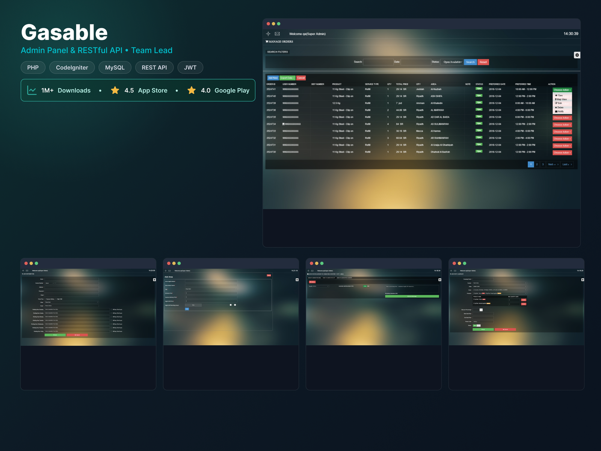

# Gasable: REST API and admin panel

## Overview

Gasable is a gas-cylinder ordering and delivery app. Customers order refills and new cylinders from their phones, and operators manage orders, distributors, delivery areas and promotions from a web admin panel. The app has since grown to **1M+ downloads** (4.5 on the App Store, 4.0 on Google Play).

## My role

- Built the **RESTful API** behind the mobile apps and the **admin panel** (about 2 years, 2017 – 2019, part-time).
- **Team lead for the mobile app developers**: coordinated development, assigned tasks and prioritized work.
- Set up a staging environment for validating new features before production release.
- Functional and regression testing across web and mobile after new features and bug fixes.

## Stack

PHP · CodeIgniter · MySQL · REST API · JWT · JavaScript · Bootstrap · Google Maps · SMS providers (Twilio, Unifonic) · Jira · Git / Bitbucket · Postman

## What the admin panel does

- **Order management**: search and filter by order, date and status; view, edit, delete and notify per order; map view; export data.
- **Distributors**: create distributors with working hours per day, express delivery and night-shift availability.
- **Areas and pricing**: define delivery areas per city with standard, express and night-shift prices.
- **Push notifications**: send messages to users by country, city or area.
- **Campaigns**: create promotions with products and quantities, discount percentage, start and end time, promo code and status.

## Technical highlights

- **API security:** JWT-based authentication and authorization protecting the mobile API.
- **Integrations:** Google Maps and SMS providers (Twilio, Unifonic).
- **Release process:** staging environment and regression testing before production releases.
<!-- TODO: add one or two specifics you remember, such as how orders were assigned to distributors, or how notifications were targeted by area. -->

## Results

- A production app used by customers and operators across cities such as Riyadh, Jeddah, Mecca and Amman.
- The app now has 1M+ downloads, which reflects the product's growth since my time on the team.
<!-- TODO: add anything measurable from your tenure, such as number of cities launched, orders per day, or API response times. -->

[← Back to all case studies](README.md)
