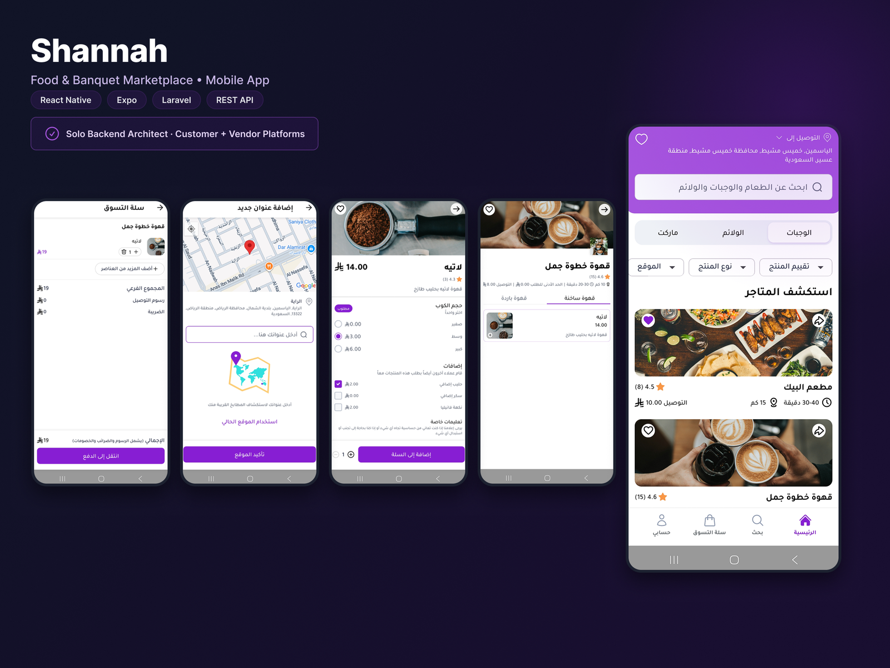

# Shannah: food and banquet marketplace

## Overview

A marketplace mobile app (Arabic, RTL) where customers browse restaurants, cafes and banquet providers, build a cart and place orders, with a matching platform for vendors to manage their menus and orders.

## My role

**Solo backend architect** for both the customer and vendor platforms, plus React Native development.

## Stack

Laravel · REST API · React Native · Expo

## Features

- **Home and discovery:** search across dishes, banquets and market items, with filters for rating, product type and location.
- **Store pages:** store details, delivery information and menu sections.
- **Product options:** required choices such as size, optional add-ons with prices, and special instructions.
- **Cart:** line items, subtotal, delivery fee and tax.
- **Addresses:** a map-based address picker with current-location support.
- **Full Arabic RTL experience.**
<!-- TODO: add vendor-side features you built (order management, menu management, payouts, etc.). -->

## Technical highlights
<!-- TODO: describe key backend decisions, such as order lifecycle, vendor and customer roles, payments, and notifications. -->

[← Back to all case studies](README.md)
