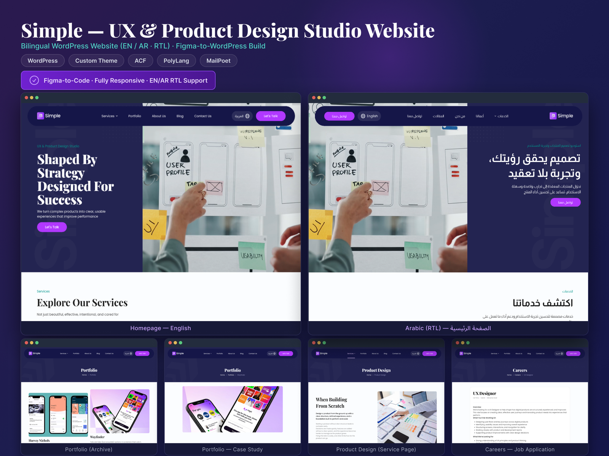

# Simple: bilingual UX studio website (WordPress)

## Overview

A marketing website for a UX and product design studio, built from a Figma design as a **custom WordPress theme**. The site is fully bilingual, with English (LTR) and Arabic (RTL) versions that mirror each other.

## My role

Figma-to-WordPress build: custom theme development, content structure, language switching and email signup.

## Stack

WordPress · Custom theme · ACF (Advanced Custom Fields) · PolyLang · MailPoet

## Pages built

- Home page (English and Arabic)
- Portfolio archive and portfolio case-study pages
- Service page (Product Design)
- Careers and job-application pages

## Technical highlights

- **Figma-to-code:** a fully responsive implementation faithful to the design.
- **RTL support:** the Arabic version mirrors layout, navigation and typography, not just the text.
- **Content modeling with ACF:** custom fields and reusable templates so the studio can manage portfolio items, services and job listings from the WordPress admin.
- **Multilingual with PolyLang:** a language switcher in the header and translated content for every page.
- **MailPoet:** newsletter signup integrated into the theme.
<!-- TODO: add any performance numbers (Lighthouse score, page weight) or notable challenges you remember. -->

[← Back to all case studies](README.md)
