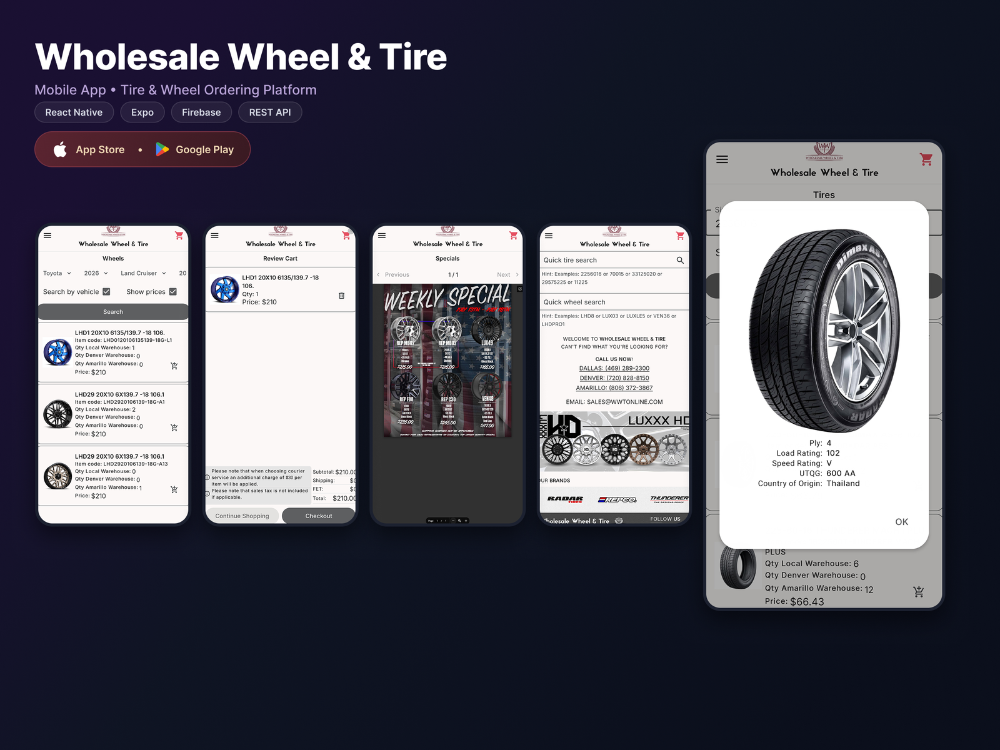

# Wholesale Wheel & Tire: mobile ordering app

## Overview

A mobile app (iOS and Android) that lets a wholesale tire and wheel supplier's customers find products, check stock across warehouses and place orders from their phones.

## My role

Built the mobile app, integrating it with the client's REST API and Firebase.

## Stack

React Native · Expo · Firebase · REST API

## Features

- **Search by vehicle:** pick make, year and model to find matching wheels and tires.
- **Quick tire and wheel search:** find products directly by item code, with search hints.
- **Per-warehouse stock:** each product shows quantity at the local warehouse and the other warehouses, so buyers see what's available right away.
- **Cart and checkout:** review the cart with subtotal, shipping, federal excise tax (FET) and total, plus courier-service notes.
- **Product details:** specifications such as ply, load rating, speed rating, UTQG and country of origin.
- **Weekly specials and brands:** a specials flyer viewer and a contact screen with the company's locations.

## Technical highlights

- A single codebase for iOS and Android using Expo.
- Data-dense product lists designed to stay readable on small screens.
<!-- TODO: add what you remember about Firebase usage (push notifications, auth, analytics?), the search flow, or how you handled the product catalog size. -->

## Results

- Published on the App Store and Google Play.
<!-- TODO: add anything measurable, such as catalog size, delivery time, or client feedback. -->

[← Back to all case studies](README.md)
